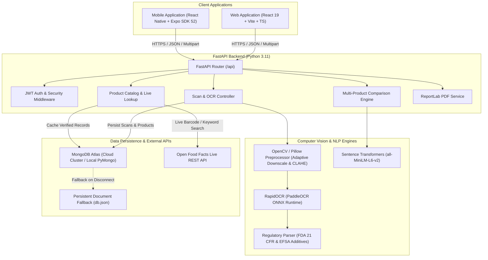

# LabelLens — System Architecture & Design Specification

**Architecture Version:** 1.0.0  
**Target Environment:** Production Cloud (Render + Vercel + MongoDB Atlas) & Local Docker

---

## 1. High-Level Architecture Overview

LabelLens follows a clean layered microservice/monorepo architecture separating client applications (Web & Native Mobile), API mediation, deep learning computer vision, regulatory natural language processing, and persistent document storage.

---

## 2. Layered Responsibilities

### 2.1 Presentation Tier
- **Web App (`frontend/`)**: Single-page application built on React 19, TypeScript, and Vite. Implements the Forest Green (`#174D36`) and Warm Cream (`#FAF7F0`) design language with interactive Donut Gauges and responsive navigation.
- **Mobile App (`mobile/`)**: Native cross-platform application built with React Native and Expo SDK 52. Integrates with the device's hardware camera and photo gallery, with auto-detected gateway routing (`10.0.2.2` for Android emulator, LAN IP for physical device).

### 2.2 API & Business Logic Tier (`backend/`)
- **FastAPI Core**: Asynchronous ASGI server running on Uvicorn. Implements request validation via Pydantic v2 schemas and OpenAPI auto-documentation.
- **Authentication & RBAC (`routes/auth.py`)**: Cryptographic password hashing via `passlib[bcrypt]`, stateful JWT token validation with customizable expiration, and GDPR-compliant personal data export/deletion.
- **Product Engine (`routes/products.py`)**: Seamless synchronization with Open Food Facts API, transforming heterogeneous external payloads into standardized `Product` models.
- **Comparison Engine (`routes/comparisons.py`)**: Algorithmic ranking of up to 3 products based on explicit user health targets (`Lower Sugar`, `Higher Protein`, `Lower Sodium`, `Clean Label`).

### 2.3 Deep Learning & Artificial Intelligence Tier (`backend/services/`)
- **OCR Service (`ocr_service.py`)**: PaddleOCR directional text detector and text recognizer executed via ONNX Runtime. Automatic image downscaling ensures execution within 512MB RAM cloud containers.
- **NLP Ingredient Intelligence (`nlp_service.py`)**: Deterministic tokenizer and regulatory knowledge base mapping chemical nomenclature (e.g., E-numbers, preservatives, artificial colorants) to FDA and EFSA safety guidelines.
- **Semantic Vector Engine (`semantic_service.py`)**: Semantic embedding calculations for fuzzy similarity matching against user-defined ingredient watchlists.

### 2.4 Data Persistence Tier (`backend/database.py`)
- **Primary Database**: MongoDB / MongoDB Atlas using `pymongo.MongoClient`.
- **Zero-Config Resilient Fallback**: If an external cluster is unreachable or unconfigured, the system automatically pivots to persistent JSON document storage in `backend/data/db.json` without failing requests or dropping transactions.

---

## 3. Security & Privacy Architecture

1. **Zero Credential Hardcoding**: Database strings, secret keys, and ports are read dynamically from OS environment variables (`MONGODB_URI`, `JWT_SECRET`, `PORT`).
2. **CORS Governance**: Configured via FastAPI CORSMiddleware with explicit support for web origin requests.
3. **No Demo Data in Production**: All collections start completely empty. Metrics on dashboards are aggregated dynamically from user-owned records.
