# LabelLens — Deep Learning OCR & Document Extraction Pipeline

**Pipeline Version:** 2.0.0  
**Inference Engine:** PaddleOCR ONNX Runtime (`RapidOCR`)  
**Processing Target:** Real Food Packaging Labels, Nutrition Facts Tables, and Ingredient Lists.

---

## 1. Complete Pipeline Stages

```mermaid
graph LR
    A[Image Upload] --> B[Validation & Safe Naming]
    B --> C[Adaptive Downscaling <=1500px]
    C --> D[Grayscale & CLAHE Contrast]
    D --> E[Unsharp Mask Sharpening]
    E --> F[PaddleOCR Text Detection]
    F --> G[Direction Classification]
    G --> H[PaddleOCR Text Recognition]
    H --> I[Line Reassembly & Confidence Scoring]
    I --> J[Structured Layout Parsing]
    J --> K[Human Review & Correction Workspace]
```

---

## 2. Image Preprocessing (OpenCV & Pillow)

Preprocessing optimizes the signal-to-noise ratio before passing pixel arrays into the convolutional text detector:

1. **Adaptive Cloud Downscaler**: High-resolution mobile phone camera photos (e.g., 4000×3000px) are downscaled using `Image.Resampling.LANCZOS` so the longest edge does not exceed `1500px`. This preserves sub-millimeter typography while keeping memory usage under 200MB, preventing OOM crashes on free-tier containers.
2. **Grayscale Conversion**: Eliminates color noise, foil reflections, and colored background distractors.
3. **Contrast Enhancement**: Evaluates adaptive contrast stretching to separate light text from dark packaging or vice-versa.
4. **Edge Sharpening**: Applies unsharp masking (`ImageEnhance.Sharpness(1.4)`) to restore crisp boundaries on small font weights (6pt–8pt).

---

## 3. Deep Learning OCR Inference (PaddleOCR ONNX)

- **Text Detection Model**: Differentiable Binarization (`DBNet`) extracts text bounding boxes with arbitrary quadrilateral shapes.
- **Direction Classifier**: Detects text orientation (`0°` vs `180°`) to prevent inverted recognition on package sides.
- **Text Recognition Model**: MobileNetV3 backbone paired with a Connectionist Temporal Classification (`CTC`) decoder.
- **Output Artifacts**: Bounding polygon coordinates, raw Unicode text string, and per-token confidence probability $[0.0, 1.0]$.

---

## 4. Structured Document Extraction Engine

The extracted line array is ingested by `backend/services/ocr_service.py` using multi-pattern regex heuristics:

### 4.1 Serving Size & Unit Detection
- Searches for patterns like `Serving Size\s*:\s*(\d+(\.\d+)?)\s*(g|ml|oz|cup)`.
- Handles fractional representations such as `1/2 cup` or `3/4 tbsp`.

### 4.2 Nutrition Parsing Matrix
Matches both European/International standard tables (`per 100g`) and US FDA panels (`per serving`):
- **Energy / Calories**: `Calories\s*(\d+)`, `Energy\s*(\d+)\s*kcal`.
- **Total Fat & Saturated Fat**: `Total\s*Fat\s*(\d+(\.\d+)?)g`, `Saturated\s*Fat\s*(\d+(\.\d+)?)g`.
- **Carbohydrates & Sugars**: `Total\s*Carb[a-z]*\s*(\d+(\.\d+)?)g`, `Total\s*Sugars?\s*(\d+(\.\d+)?)g`.
- **Dietary Fiber**: `Dietary\s*Fiber\s*(\d+(\.\d+)?)g`.
- **Protein**: `Protein\s*(\d+(\.\d+)?)g`.
- **Sodium**: `Sodium\s*(\d+(\.\d+)?)mg` (with automatic conversion if reported in grams).

### 4.3 Ingredient Boundary Segmentation
- Identifies the start token `INGREDIENTS:` or `CONTAINS:`.
- Splits tokens across commas, semicolons, and parentheses while preserving nested additive groups (e.g., `"Leavening (Baking Soda, Ammonium Bicarbonate)"`).

---

## 5. Quality Assurance & Error Metrics

In accordance with strict verification standards, the pipeline evaluates text extraction accuracy using:

- **Character Error Rate (CER)**:
  $$\text{CER} = \frac{S + D + I}{N}$$
  *(where $S$ is substitutions, $D$ is deletions, $I$ is insertions, and $N$ is total ground-truth characters).*
- **Word Error Rate (WER)**: Evaluates Levenshtein distance on token sequences.
- **Review Trigger (`needs_review`)**: If average OCR confidence drops below $0.75$, the extraction is flagged for user verification in the Review Workspace.
